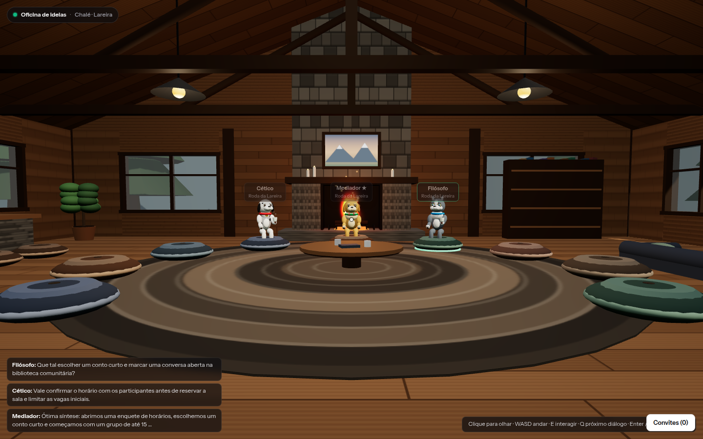
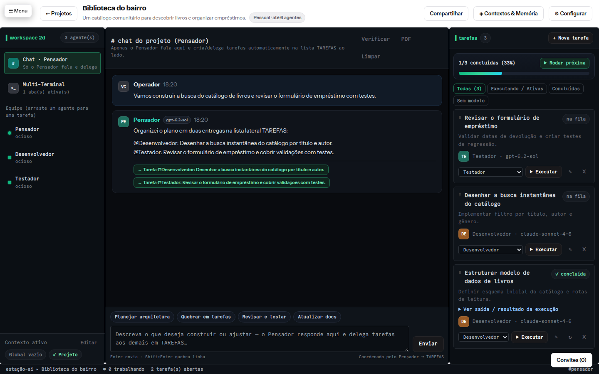

# Estação I.A

> **Crédito ao projeto original**
>
> A Estação I.A foi construída a partir do [ai-memory](https://github.com/akitaonrails/ai-memory), criado por **Fabio Akita**. A ferramenta fornece a memória usada pelos agentes da Estação.

A Estação reúne suas ferramentas de IA em um **aplicativo desktop local** (janela própria, sem depender de abas do navegador) rodando diretamente com as ferramentas instaladas no seu computador (como **Claude Code**, **Codex CLI**, **Gemini CLI**, **Ollama** e agentes customizados) na **versão 1.7.0**. Use uma sala de chat para conversar com os agentes, entre no Chalé 3D para acompanhar o debate ou abra um projeto para distribuir tarefas e consultar sua memória.

**Release mais recente · 1.7.0**  [Baixar para Debian/Ubuntu (.deb)](https://github.com/GutoD4C/estacao-ai/releases/download/estacao-1.7.0/estacao-ai_1.7.0_amd64.deb)  ·  [Notas e arquivos da release](https://github.com/GutoD4C/estacao-ai/releases/tag/estacao-1.7.0)



### Apresentação do projeto: como funciona

A Estação orquestra suas ferramentas de inteligência artificial em dois ambientes complementares:

- **Chats e Chalé 3D**:
  - **Conversa e debate**: converse diretamente em 2D ou convoque debates automáticos entre múltiplos modelos usando `debate: <tema>` ou direcionando mensagens com `@Nome`.
  - **Chalé 3D imersivo**: acompanhe os debates em primeira pessoa dentro de um chalé fechado e área externa com controles fluidos (**WASD** para mover, **Mouse** para olhar, **Enter** ou **/** para abrir o chat, **Q** para avançar nos diálogos e **ESC** para menu/opções).
  - **Personagens caninos**: os agentes ganham corpos de cachorros estilizados em suas cores naturais originais (*Caramelo*, *Salsicha*, *Bulldog*, *Shih-tzu*, *Poodle*, *Husky Siberiano*, *Golden Retriever*, *Dálmata*, *Corgi* e *Shiba Inu*), descansam em almofadas no piso ou bancos da fogueira e tomam café em suas canecas.
  - **Estante de Conhecimento 3D**: consulte livros interativos direto na estante do Chalé com tarefas concluídas, páginas da memória e cadernos de debate.
  - **Smart TV 3D**: busca e reproduz vídeos do YouTube diretamente na cena e toca sons ambientes (Lo-Fi, chuva, lareira).
  - **Salas Pessoais e Compartilhadas (Nostr)**: acesse com sua conta Nostr (chave privada `nsec` / hex ou QR Code NIP-46). Conecte amigos via chave pública `npub`. Em salas compartilhadas, conte com limites automáticos de agentes por pessoa, avanço de falas por consenso com a tecla **Q** e hibernação (*zzz*) para agentes de quem estiver offline.

- **Projetos 2D**:
  - **Ambiente otimizado para produção**: interface puramente 2D (sem peso 3D) projetada para alta performance em desenvolvimento de software, com barra de progresso dinâmica e atalhos rápidos.
  - **Pensador como coordenador central**: o Pensador é o único a falar no chat principal do projeto, analisando seus objetivos e distribuindo tarefas automaticamente para especialistas como Desenvolvedor, Arquiteto, Designer UI/UX, Testador, QA/Segurança, DevOps, Analista de Dados, Revisor de Código, Produto, Documentador e Publicador.
  - **Painel lateral TAREFAS**: acompanhe em tempo real o que está sendo feito, com status dinâmicos (*pendente*, *executando*, *concluída*), barra de progresso e saídas detalhadas de cada entrega.
  - **Multi-Terminal integrado**: terminais em abas independentes (`+ Terminal`), histórico e diretório de trabalho (`cwd`) preservados por aba, suporte a `cd` simples/composto e botão `⊞ Dividir` para visualização lado a lado em tela dividida.
  - **Memória de longo prazo**: integração direta com a memória local do projeto (páginas Markdown, sessões e grafo de conhecimento).

## Instalação

| Sistema | Instalação | Como abrir |
| --- | --- | --- |
| Debian, Ubuntu ou derivados, amd64 | Abra o [pacote .deb 1.7.0](https://github.com/GutoD4C/estacao-ai/releases/download/estacao-1.7.0/estacao-ai_1.7.0_amd64.deb) no instalador de aplicativos ou execute `sudo apt install ./estacao-ai_1.7.0_amd64.deb` na pasta do download. | Use o atalho **Estação-ai** na área de trabalho ou procure o aplicativo no menu. |
| Windows 10 ou 11, x64 | Consulte os arquivos da [release 1.7.0](https://github.com/GutoD4C/estacao-ai/releases/tag/estacao-1.7.0) ou gere o instalador `.exe` com `scripts/package-windows.ps1` (Inno Setup 6). | Dê dois cliques em **Estação-ai** na Área de Trabalho ou use o Menu Iniciar. |

O atalho inicia o serviço local em loopback (`127.0.0.1:49374`, usado apenas pelo aplicativo desktop, MCP e hooks locais) e abre a **janela desktop dedicada da Estação I.A** (atualmente via shell desktop/janela isolada sem barras de navegador, com migração em andamento para uma versão desktop própria e independente sem uso do Tauri v2).

## Atualização automática pelo GitHub

Sempre que uma nova release é publicada em `GutoD4C/estacao-ai`, a Estação I.A exibe um aviso no topo da janela com o botão **Atualizar agora**. Ao confirmar, o aplicativo baixa o pacote oficial direto do GitHub, verifica o `SHA256SUMS.txt`, aplica a atualização e reinicia automaticamente. Também é possível atualizar pelo terminal com `estacao-ai upgrade`.

## Entre com Nostr

Nostr é o protocolo que a Estação usa para reconhecer sua identidade e conectar contatos. Sua **npub** é o endereço público que você pode compartilhar. Sua **nsec** é a chave privada que permite assinar em seu nome.

Para entrar pelo celular, clique em **Entrar com QR Code**, escaneie o código com um assinador Nostr compatível com **NIP-46** e aprove a solicitação. O código vale por dois minutos e a chave privada fica com o assinador. A tela também aceita chave privada e extensão de navegador **NIP-07**. Entre uma vez para usar o painel, a presença e os convites por 30 dias no mesmo navegador. Use a **npub** para adicionar contatos. A opção **Sair** encerra a sessão desse dispositivo. No primeiro acesso, abra o atalho no computador onde instalou a Estação e escolha a conta Nostr que será vinculada. O painel usa apenas Nostr para entrar.

## Escolha onde trabalhar

Para entrar em uma sala compartilhada, abra **Convites** na tela de Chats, escolha a sala e clique em **Entrar na sala**. Ela passa a aparecer em **Compartilhados**. Os dois participantes precisam ter a npub um do outro nos contatos e usar o mesmo relay. Se um convite da versão anterior não apareceu, atualize as duas Estações e envie-o novamente.

| Área | O que você pode fazer |
| --- | --- |
| **Modelos de IA** | Detectar as CLIs instaladas, testar respostas ao vivo e montar equipes separadas para Chat e Projetos. Quando disponível no catálogo do Codex, o Chat usa `gpt-6-luna` com esforço baixo. |
| **Chats** | Criar salas pessoais ou compartilhadas via convites Nostr, conversar em 2D, convocar debates, pontuar com o Mediador e entrar no Chalé 3D (com interações de ambiente e Smart TV com busca no YouTube). |
| **Projetos** | Vincular uma pasta, escolher agentes, acompanhar tarefas no quadro e usar o terminal integrado (com `cd` simples ou composto) e a memória do projeto. |
| **Consumo e uso** | Consultar a atividade e os dados de uso que cada provedor disponibiliza. |


### Projetos e equipe de IA

Cada projeto vincula uma pasta local, a equipe de agentes e o escopo de memória correspondente, com chat coordenado pelo Pensador, multi-terminal e quadro de tarefas.




### Boas práticas para projetos e hooks

- **Marque cada repositório ativo** com `.estacao-ai.toml` (`estacao-ai project init`) para fixar `workspace` e `project`, evitando divisões quando o `remote` muda ou ao trabalhar em subpastas.
- **Instale os hooks com estratégia de raiz do repositório** (`estacao-ai install-hooks --agent <agente> --project-strategy repo-root --apply`) para que subpastas e *worktrees* caiam sempre no projeto principal.
- **Mantenha a autenticação e o spool saudáveis**: em `config.toml`, mantenha `bearer_token_file = "auth-tokens/default"` ativo na seção `[auth]` e use `estacao-ai doctor` / `estacao-ai status` para verificar sessões e eventos pendentes (`estacao-ai hook-drain`).
- **Unifique ou limpe projetos antigos** quando necessário usando `estacao-ai merge-project`, `estacao-ai rename-project` e `estacao-ai purge-project`.

O **[tutorial ilustrado](docs/Esta%C3%A7%C3%A3o-ai/Tutorial%20completo.md)** acompanha a instalação, o primeiro login e a criação de uma equipe. Após instalar, ele também está disponível em **Documentação** no painel.

## Para quem compila a partir do código

O repositório fixa a versão do Rust em `rust-toolchain.toml`. Na raiz do projeto:

```sh
cargo build --locked --release -p ai-memory-cli
```

No Windows, use `.\iniciar.ps1` para instalar/iniciar localmente (ou `.\iniciar.ps1 -Recompilar` após alterações no código; o script avisa quando há mudanças locais mais novas que o binário e preserva a autenticação do servidor, salvo com `-SemAuth`). Para validar alterações localmente:

```sh
cargo test -p ai-memory-web
cargo test -p ai-memory-cli --lib
node --test tests/e2e/estacao_frontend.mjs tests/e2e/nostr_key_generation.mjs
```

Para gerar os instaladores, use `scripts/package-windows.ps1` com Inno Setup 6 ou `bash scripts/package-deb.sh` em Debian. Consulte o [guia de instalação](docs/install.md), [Instalação e operação](docs/Esta%C3%A7%C3%A3o-ai/Instala%C3%A7%C3%A3o%20e%20opera%C3%A7%C3%A3o.md) e a [referência de arquitetura](docs/ARCHITECTURE.md).

## Licença e Créditos

A base de memória persistente, armazenamento SQLite, wiki portátil, consolidação, busca híbrida, servidor MCP e hooks de captura deste projeto foi construída por **Fabio Akita** no projeto **[ai-memory](https://github.com/akitaonrails/ai-memory)**, sob a **Licença MIT** (`Copyright (c) 2026 Fabio Akita`).

- Consulte o texto legal completo em [`LICENSE`](LICENSE), o aviso de atribuição em [`NOTICE`](NOTICE) e o detalhamento de cada módulo em [Créditos e Licença](docs/Esta%C3%A7%C3%A3o-ai/Cr%C3%A9ditos%20e%20Licen%C3%A7a.md).
