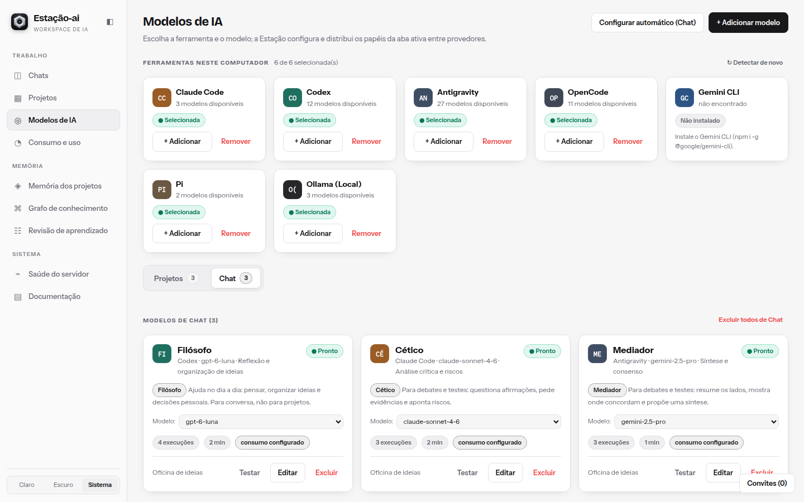
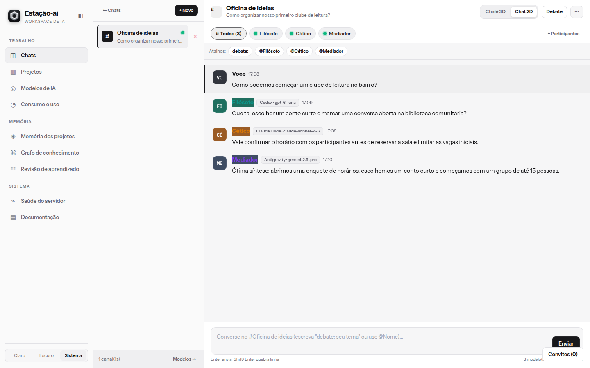

# Estação I.A

> **Crédito ao projeto original**
>
> A Estação I.A foi construída a partir do [ai-memory](https://github.com/akitaonrails/ai-memory), criado por **Fabio Akita**. A ferramenta fornece a memória persistente usada pelos agentes da Estação.

A Estação I.A reúne suas ferramentas de inteligência artificial em um **aplicativo desktop local** (janela própria, sem depender de abas do navegador) rodando diretamente com as CLIs instaladas no seu computador (como **Claude Code**, **Codex CLI**, **Gemini CLI**, **Antigravity**, **OpenCode**, **Pi**, **Ollama** e agentes customizados).

**Release mais recente · 1.7.5**  [Baixar para Windows (.exe)](https://github.com/GutoD4C/estacao-ai/releases/download/estacao-1.7.5/Estacao-ai-Setup-win10-11-x64.exe)  ·  [Baixar para Debian/Ubuntu (.deb)](https://github.com/GutoD4C/estacao-ai/releases/download/estacao-1.7.5/estacao-ai_1.7.5_amd64.deb)  ·  [Notas e arquivos da release](https://github.com/GutoD4C/estacao-ai/releases/tag/estacao-1.7.5)


## Instalação e abertura

| Sistema | Instalação | Como abrir |
| --- | --- | --- |
| Debian, Ubuntu ou derivados, amd64 | Abra o [pacote .deb 1.7.5](https://github.com/GutoD4C/estacao-ai/releases/download/estacao-1.7.5/estacao-ai_1.7.5_amd64.deb) no instalador de aplicativos ou execute `sudo apt install ./estacao-ai_1.7.5_amd64.deb` na pasta do download. | Use o atalho **Estação-ai** na área de trabalho ou procure o aplicativo no menu. |
| Windows 10 ou 11, x64 | Baixe e execute o [instalador Windows (.exe) 1.7.5](https://github.com/GutoD4C/estacao-ai/releases/download/estacao-1.7.5/Estacao-ai-Setup-win10-11-x64.exe) (não precisa compilar nem abrir terminal; também há o [executável portátil](https://github.com/GutoD4C/estacao-ai/releases/download/estacao-1.7.5/Estacao-ai-win10-11-x64.exe)). | Dê dois cliques em **Estação-ai** na Área de Trabalho ou use o Menu Iniciar. |

O atalho inicia o serviço local em loopback (`127.0.0.1:49374`, usado apenas pelo aplicativo desktop, MCP e hooks locais) e abre a **janela desktop dedicada da Estação I.A**.

No Windows, fechar a janela mantém o serviço na bandeja, ao lado do relógio. Clique no ícone para abrir novamente ou use **Fechar Estação I.A de vez** no menu do ícone para encerrar o aplicativo.

### Atualização automática pelo GitHub

Sempre que uma nova release é publicada em `GutoD4C/estacao-ai`, a Estação I.A exibe um aviso no topo da janela com o botão **Atualizar agora**. Ao confirmar, o aplicativo baixa o pacote oficial direto do GitHub, verifica o `SHA256SUMS.txt`, aplica a atualização e reinicia automaticamente. Também é possível atualizar pelo terminal com `estacao-ai upgrade`.

## Funções da Estação I.A: para que serve e como utilizar

| Módulo | Para que serve | Onde acessar no painel |
| --- | --- | --- |
| **Chats e Chalé 3D** | Conversar e debater ideias com vários modelos ao mesmo tempo, em lista 2D ou dentro do Chalé 3D. | Menu **Chats** |
| **Projetos 2D** | Executar entregas reais em repositórios com Pensador, quadro de tarefas, equipe especialista e multi-terminal. | Menu **Projetos** |
| **Memória dos Projetos** | Guardar decisões, regras, sessões e conhecimento contínuo em Markdown + SQLite; exportar, importar, verificar e excluir. | Menu **Projetos** → **Memórias dos Projetos** |
| **Modelos de IA** | Detectar CLIs instaladas na máquina, testar conectividade e montar equipes separadas para Chat e Projetos. | Menu **Modelos de IA** |
| **Consumo e uso** | Acompanhar atividade local e métricas de uso informadas pelos provedores instalados. | Menu **Consumo** |
| **Identidade e Salas Nostr** | Autenticar o acesso local e conectar contatos (`npub`) para colaborar em salas e projetos compartilhados. | Tela de login / botão **Conta Nostr** e **Convites** |

---

### 1. Memória dos Projetos (Exportar, Importar, Verificar e Excluir)

**Para que serve:** evita que os agentes esqueçam decisões de arquitetura, regras do time, erros já resolvidos (*gotchas*) e histórico de sessões entre execuções. Cada repositório ganha um escopo próprio no formato `workspace/projeto` (com páginas Markdown indexadas em SQLite e busca híbrida), além da memória global compartilhada `default/_global`.

**Como utilizar no dia a dia:**

O arquivo de memória leva o conhecimento consolidado: texto completo, regras, decisões, aprendizados, entidades, relações e links entre páginas. Ao importar no outro computador, a Estação reconstrói os índices e o grafo a partir desse conteúdo. Exporte juntos os projetos ligados entre si e inclua a memória global para levar também as preferências compartilhadas. Os registros brutos das sessões e as credenciais dos provedores ficam fora desse arquivo; para copiar toda a instalação, use `estacao-ai backup` e `restore`.

1. **Ativar uma memória detectada:** quando você trabalha em uma pasta via hooks ou CLI, ela aparece em **Projetos** → **Projetos detectados na memória**. Clique em **Ativar e abrir →** (ou **Escolher modelos**) para criar um projeto 2D ligado àquela memória.
2. **Fixar o escopo no repositório (`.estacao-ai.toml`):** abra o projeto ou execute `estacao-ai project init` na raiz do repositório para gravar `.estacao-ai.toml` (`workspace = "..."` e `project = "..."`). Assim, subpastas e *worktrees* nunca criam memórias duplicadas.
3. **Verificar individualmente cada memória:** na seção **Memórias dos Projetos** (tela **Projetos**), clique em **Verificar** na linha de qualquer memória para abrir a janela de inspeção com:
   - Total de páginas e sessões, pasta detectada, status do `.estacao-ai.toml` e projetos vinculados;
   - Campo de busca para filtrar páginas por título, caminho ou tipo (`rule`, `decision`, `gotcha`, `concept`, `procedure`, `session`, `note`);
   - Expansão individual (**Ver conteúdo completo**) para ler o texto salvo e consultar sessões recentes.
4. **Exportar (seleção total ou individual):**
   - **Exportação individual:** clique em **Exportar** diretamente na linha da memória desejada para baixar um arquivo `.json` apenas daquele projeto.
   - **Seleção total ou múltipla:** marque a caixa **Selecionar todas** no topo da lista (ou escolha apenas as memórias desejadas) e clique em **Exportar selecionadas** para gerar um pacote único portátil (`estacao-ai-memoria-v1`).
5. **Importar memórias em outro computador ou workspace:**
   - Clique em **⬇ Importar memória** (no topo de **Projetos** ou no cabeçalho de **Memórias dos Projetos**).
   - Selecione o arquivo `.json` exportado e confira o resumo (quantidade de projetos e páginas, indicando quais já existem localmente e quais são novos).
   - Expanda **Verificar página(s) deste projeto** se quiser conferir o conteúdo antes de importar.
   - Escolha entre **Mesclar** (preserva o que já existe localmente e adiciona/atualiza as páginas do arquivo) ou **Substituir** (recria do zero cada projeto selecionado — a memória `default/_global` sempre usa Mesclar por segurança).
   - Use **Selecionar todas** ou marque projetos específicos e clique em **Importar selecionadas**.
6. **Excluir individualmente:**
   - Clique em **Excluir** na memória que deseja remover. Após confirmação, todas as páginas, sessões e arquivos da wiki daquele projeto são apagados permanentemente e qualquer projeto local que apontava para ela é desvinculado sem perder suas configurações locais.
   - Para apenas limpar visualmente a seção *Projetos detectados na memória* sem apagar os dados, use **Ocultar** / **Reexibir**. A memória global `default/_global` é protegida e não pode ser excluída.

**Comandos complementares via terminal (`estacao-ai`):**

- `estacao-ai merge-project` / `estacao-ai rename-project` / `estacao-ai purge-project`: unifica, renomeia ou remove escopos diretamente pelo terminal.
- `estacao-ai project init`: gera `.estacao-ai.toml` na pasta atual.
- `estacao-ai install-hooks --agent <agente> --project-strategy repo-root --apply`: instala os hooks de captura apontando sempre para a raiz do repositório.

---

### 2. Modelos de IA e CLIs locais



**Para que serve:** centraliza as ferramentas de IA já instaladas no computador sem precisar configurar chaves de API duplicadas manualmente e permite montar equipes distintas para **Projetos** (trabalho em código/arquivos) e **Chat** (conversas e debates).

**Como utilizar:**

1. Acesse **Modelos de IA** no menu lateral. A Estação verifica automaticamente o sistema (`claude`, `codex`, `gemini`, `agy`, `opencode`, `pi`, `ollama`).
2. Se acabou de instalar uma CLI (como o Codex CLI no Windows), clique em **Atualizar catálogo** para reescanear caminhos padrão do sistema e arquivos de cache locais.
3. Use **Auto-configurar equipe** para montar rapidamente os papéis de Projetos ou Chat, ou clique em **+ Adicionar modelo** para cadastrar uma CLI, modelo específico e papel na equipe. Quando disponível no catálogo do Codex, o Chat usa `gpt-6-luna` com esforço baixo.
4. Use **Testar** no cartão de qualquer agente para validar a resposta ao vivo antes de colocá-lo em um projeto.

---

### 3. Chats 2D e Chalé 3D



**Para que serve:** reunir múltiplos modelos de IA em uma sala para discutir ideias, fazer *brainstorming*, comparar abordagens e consultar sua base de conhecimento.

**Como utilizar:**

- **Chat 2D e debates:** escreva normalmente para todos os agentes da sala ou direcione com `@Nome`. Para iniciar rodadas estruturadas entre os participantes, envie `debate: <tema>` ou clique na ação de **Debate**. Também é possível solicitar verificação de ideias e pontuação interna com o **Mediador**.
- **Chalé 3D imersivo:** ative a visualização 3D dentro do chat para acompanhar os agentes como personagens caninos estilizados (*Caramelo*, *Salsicha*, *Bulldog*, *Shih-tzu*, *Poodle*, *Husky Siberiano*, *Golden Retriever*, *Dálmata*, *Corgi* e *Shiba Inu*) interagindo pela área interna e externa.
  - **Controles:** **WASD** para caminhar, **Mouse** para olhar ao redor, **Enter** ou **/** para digitar no chat, **Q** para avançar diálogos (e confirmar consenso em salas compartilhadas) e **ESC** para opções/menu.
- **Estante de Conhecimento 3D:** clique na estante da biblioteca dentro do Chalé para ler páginas salvas da memória, resumos de tarefas concluídas e cadernos de debate.
- **Smart TV 3D:** clique na TV do Chalé para buscar e reproduzir vídeos do YouTube direto na cena ou ligar sons ambientes (Lo-Fi, chuva, lareira).

---

### 4. Projetos 2D, Pensador, Tarefas e Multi-Terminal


**Para que serve:** workspace 2D focado em produtividade para desenvolvimento de software e execução coordenada de tarefas na pasta real do projeto.

**Como utilizar:**

1. Em **Projetos**, clique em **+ Novo projeto** (ou ative uma memória existente), defina a **pasta local** do projeto, vincule a **memória** e selecione até **10 agentes** pessoais.
2. No workspace do projeto, o **Pensador** coordena a conversa principal, analisa o objetivo e delega tarefas no painel lateral **TAREFAS** (*pendente*, *executando*, *concluída*) para especialistas como Desenvolvedor, Arquiteto, Designer UI/UX, Testador, QA/Segurança, DevOps, Analista de Dados, Revisor de Código, Produto, Documentador e Publicador.
3. Use o **Multi-Terminal** na parte inferior para abrir várias abas (`+ Terminal`), manter diretório de trabalho (`cwd`) independente por aba com suporte a `cd` simples/composto e ativar **`⊞ Dividir`** para trabalhar com dois terminais lado a lado.
4. Clique em **◈ Contexto global** na tela de Projetos para definir instruções compartilhadas com todos os projetos e chats.

---

### 5. Identidade Nostr e Salas Compartilhadas

**Para que serve:** protege o acesso ao painel local com identidade criptográfica Nostr (sem senha armazenada em servidores externos) e permite colaborar ao vivo com outras pessoas em **Chats** ou **Projetos Compartilhados**.

**Como utilizar:**

1. **Login no painel:** na primeira abertura, entre com **QR Code (NIP-46)** usando um assinador Nostr no celular, via extensão de navegador **NIP-07** ou chave privada (`nsec` / hex). A sessão permanece ativa por 30 dias no dispositivo (use **Sair** para encerrar).
2. **Contatos e convites:** abra **Conta Nostr** para copiar sua chave pública (`npub`) e adicionar contatos pela `npub` deles (ambos os lados precisam ter a `npub` um do outro e usar o mesmo relay).
3. **Compartilhar salas e projetos:** clique em **Compartilhar** em um Chat ou Projeto e marque os contatos desejados. Para aceitar uma sala recebida, abra **Convites** e clique em **Entrar na sala** (ela passa a aparecer na aba **Compartilhados**).
   - Limites automáticos em salas compartilhadas: até **5 agentes por pessoa** (salas de 2 pessoas) ou **3 por pessoa** (3+ pessoas), com hibernação (*zzz*) quando participantes estão offline e avanço sincronizado no Chalé 3D com a tecla **Q**.

---

### 6. Consumo e uso

**Para que serve:** acompanhar quantas execuções e segundos cada agente local consumiu na Estação, além de visualizar métricas e limites de uso fornecidos pelas CLIs instaladas (como Claude Code e Codex CLI).

**Como utilizar:** abra **Consumo** no menu lateral para consultar o painel consolidado por provedor, sessões recentes e barras de status.

---

### 7. Boas práticas para projetos, hooks e diagnóstico

- **Marque cada repositório ativo** com `.estacao-ai.toml` (`estacao-ai project init`) para fixar `workspace` e `project`, evitando divisões quando o `remote` muda ou ao trabalhar em subpastas.
- **Instale os hooks com estratégia de raiz do repositório** (`estacao-ai install-hooks --agent <agente> --project-strategy repo-root --apply`) para que subpastas e *worktrees* caiam sempre no projeto principal.
- **Mantenha a autenticação e o spool saudáveis:** em `config.toml`, mantenha `bearer_token_file = "auth-tokens/default"` ativo na seção `[auth]` e use `estacao-ai doctor` / `estacao-ai status` para verificar sessões e eventos pendentes (`estacao-ai hook-drain`).

O **[tutorial ilustrado](docs/Esta%C3%A7%C3%A3o-ai/Tutorial%20completo.md)** acompanha passo a passo a instalação, o primeiro login e a criação de uma equipe. Após instalar, ele também está disponível em **Documentação** no painel.

## Para quem compila a partir do código

O repositório fixa a versão do Rust em `rust-toolchain.toml`. Na raiz do projeto:

```sh
cargo build --locked --release -p ai-memory-cli
```

No Windows, use `.\iniciar.ps1` para instalar/iniciar localmente (ou `.\iniciar.ps1 -Recompilar` após alterações no código; o script avisa quando há mudanças locais mais novas que o binário e preserva a autenticação do servidor, salvo com `-SemAuth`). Para validar alterações localmente:

```sh
cargo test -p ai-memory-web
cargo test -p ai-memory-cli --lib
node --test tests/e2e/estacao_frontend.mjs tests/e2e/nostr_key_generation.mjs
```

Para gerar os instaladores, use `scripts/package-windows.ps1` com Inno Setup 6 ou `bash scripts/package-deb.sh` em Debian. Consulte o [guia de instalação](docs/install.md), [Instalação e operação](docs/Esta%C3%A7%C3%A3o-ai/Instala%C3%A7%C3%A3o%20e%20opera%C3%A7%C3%A3o.md) e a [referência de arquitetura](docs/ARCHITECTURE.md).

## Licença e Créditos

A base de memória persistente, armazenamento SQLite, wiki portátil, consolidação, busca híbrida, servidor MCP e hooks de captura deste projeto foi construída por **Fabio Akita** no projeto **[ai-memory](https://github.com/akitaonrails/ai-memory)**, sob a **Licença MIT** (`Copyright (c) 2026 Fabio Akita`).

- Consulte o texto legal completo em [`LICENSE`](LICENSE), o aviso de atribuição em [`NOTICE`](NOTICE) e o detalhamento de cada módulo em [Créditos e Licença](docs/Esta%C3%A7%C3%A3o-ai/Cr%C3%A9ditos%20e%20Licen%C3%A7a.md).
