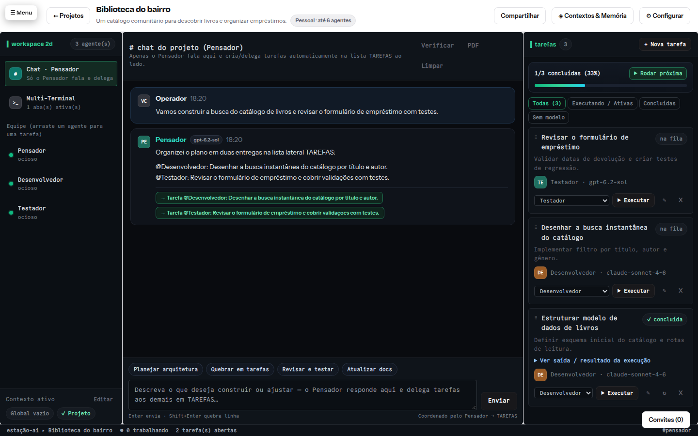

# Projetos e tarefas

## Ver todos os projetos e criar um projeto
Na aba **Projetos** aparecem todos os projetos configurados na Estação-ai **e** os projetos já detectados na memória, que podem ser ativados em 1 clique.

Em **Projetos → + Novo projeto**:
1. Nome e descrição.
2. **Pasta onde os modelos trabalham** — normalmente o repositório do projeto. As CLIs rodam nessa pasta, então os hooks de memória registram tudo no projeto certo.
3. **Modelos / aplicações de IA designados** — escolha quais [[Agentes|Modelos de IA]] participam da equipe.
4. **Memória ligada** — o escopo `workspace/projeto` da memória (ver [[Contextos e memória]]).
5. **Contexto do projeto** — diretrizes e instruções técnicas que serão consideradas por todos os modelos do projeto.

## Evitar fragmentação de projetos na memória
- Crie um arquivo `.estacao-ai.toml` na raiz de cada repositório ativo (`estacao-ai project init`) com `workspace` e `project` fixos.
- Instale os hooks com `--project-strategy repo-root` (`estacao-ai install-hooks --agent <agente> --project-strategy repo-root --apply`) para que subpastas (`frontend`, `backend`, `docs`) e *worktrees* sejam consolidados no projeto principal.
- Se algum projeto antigo ficou dividido ou acumulou pastas temporárias, organize com `estacao-ai merge-project`, `estacao-ai rename-project` e `estacao-ai purge-project`.

## Workspace 2D de alta performance
O ambiente de projetos é estritamente 2D (sem renderização 3D, garantindo agilidade e baixo uso de memória e CPU). A interface se organiza em:

- **Esquerda (Equipe & Status)**: lista os agentes do projeto, indicando seu estado ao vivo (`online`, `executando`, `ocioso` ou `hibernando/zzz` caso seu proprietário esteja offline em projetos compartilhados).
- **Centro (Chat do Pensador e Terminais)**:
  - **Pensador como porta-voz exclusivo**: no chat principal, apenas o **Pensador** fala e interage diretamente com você. Ele analisa seus pedidos, planeja a execução técnica e delega tarefas específicas para os outros agentes especialistas (Desenvolvedor, Testador, QA, etc.).
  - **Multi-Terminal integrado**: abas independentes de terminal (`+ Terminal`) com histórico próprio, persistência de diretório (`cwd`), suporte a comandos de navegação (`cd pasta && cargo test`) e modo de tela dividida (`⊞ Dividir`) para visualização lado a lado.
- **Direita (Painel Lateral TAREFAS)**: lista dinâmica de tarefas com acompanhamento em tempo real do que está sendo executado, status (*pendente*, *executando*, *concluída* ou *erro*), botão de criação (`+ Nova tarefa`), reatribuição e logs completos de cada entrega.
