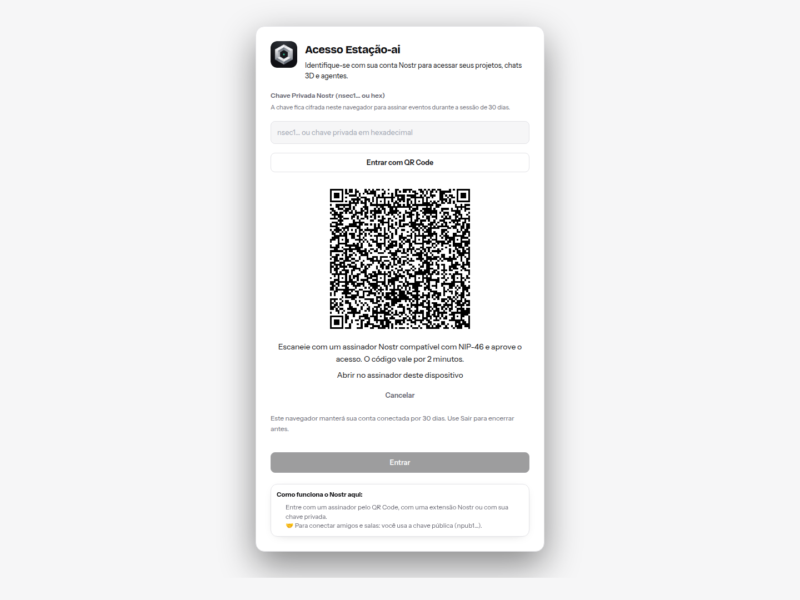
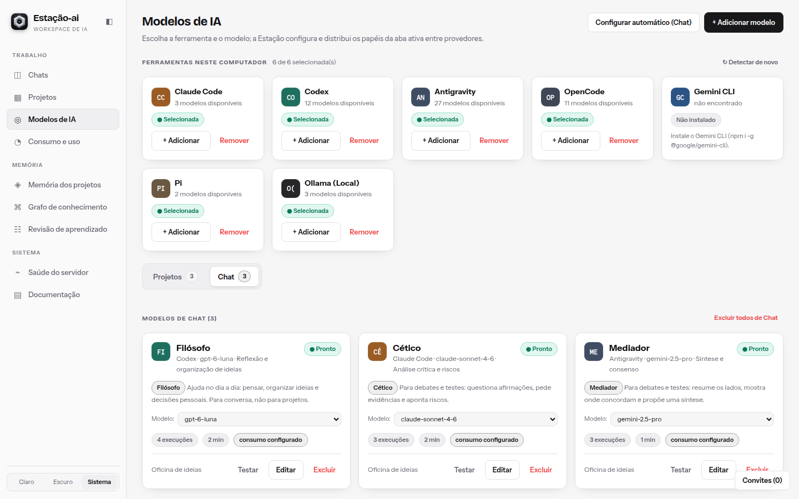
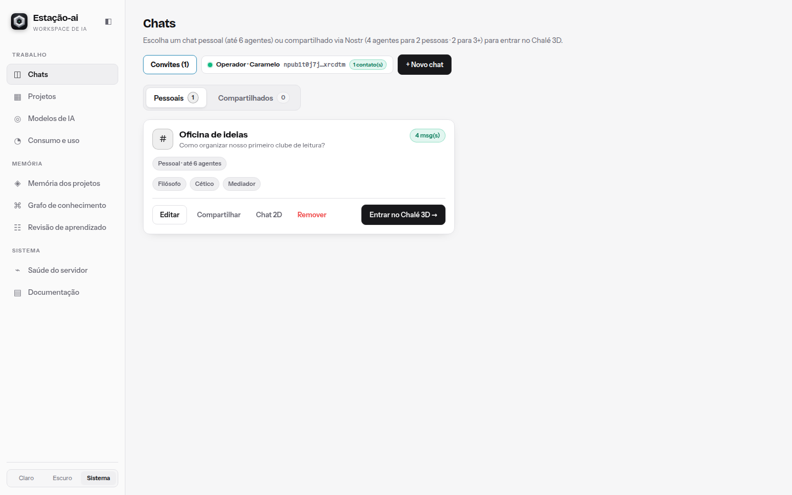
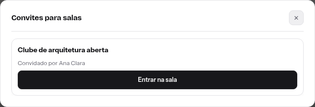
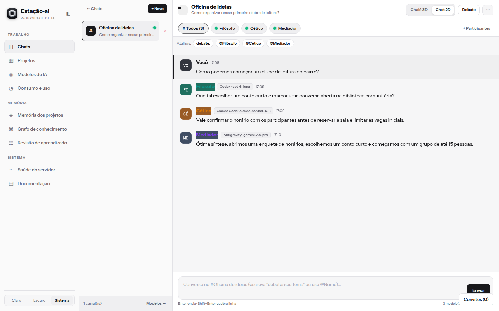
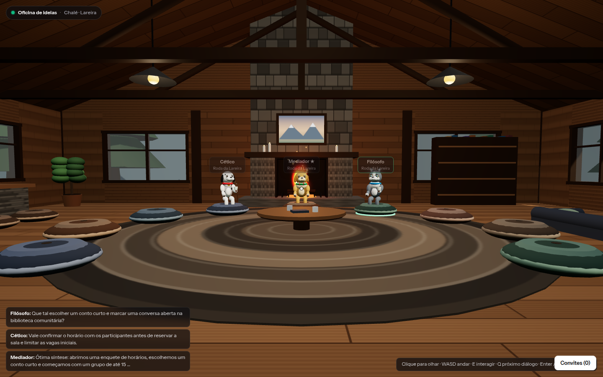
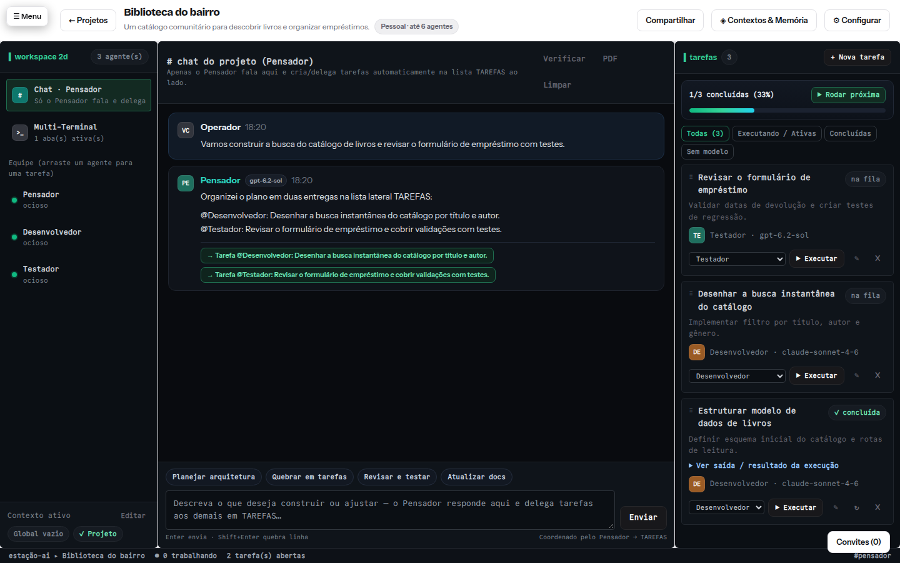

# Tutorial da Estação I.A

Este guia acompanha uma sessão de exemplo, da instalação à primeira tarefa. A versão atual do sistema é a **1.7.4**.

## 1. Instalação e execução

**Debian ou Ubuntu amd64.** Abra o pacote na central de aplicativos ou, na pasta do download, execute o comando abaixo. O APT resolve as dependências e instala o atalho no menu de aplicativos e na área de trabalho. [Baixar o pacote Debian 1.7.4](https://github.com/GutoD4C/estacao-ai/releases/download/estacao-1.7.4/estacao-ai_1.7.4_amd64.deb)

```sh
sudo apt install ./estacao-ai_1.7.4_amd64.deb
```

**Windows 10 e 11 x64.** Baixe e execute o [instalador Windows (.exe) 1.7.4](https://github.com/GutoD4C/estacao-ai/releases/download/estacao-1.7.4/Estacao-ai-Setup-win10-11-x64.exe) com sua conta habitual (sem precisar compilar nem usar comandos; também disponível como [executável portátil](https://github.com/GutoD4C/estacao-ai/releases/download/estacao-1.7.4/Estacao-ai-win10-11-x64.exe)) e abra **Estação-ai** na Área de Trabalho ou no Menu Iniciar.

O instalador cria o atalho executando `estacao-ai app`. Ele inicia o serviço local em loopback (`127.0.0.1:49374`, usado apenas pela aplicação desktop, MCP e hooks locais) e abre a **janela desktop dedicada da Estação I.A** (atualmente em janela isolada de aplicação, com migração em andamento para uma versão desktop nativa e independente sem uso do Tauri v2). Você também pode acessar diretamente via navegador em [http://127.0.0.1:49374/web/chat](http://127.0.0.1:49374/web/chat).

> **Compilando pelo código no Windows:** na pasta do repositório, rode `.\iniciar.ps1` (ou `.\iniciar.ps1 -Recompilar` após alterar o código). O script preserva a autenticação do servidor quando configurada e avisa quando o código-fonte for mais recente que o binário compilado.

## 2. Identidade e acesso com Nostr

A Estação adota o protocolo descentralizado **Nostr** para autenticação, presença e sincronização segura entre dispositivos e usuários, sem logins tradicionais em servidores centralizados.

- **Chave pública (`npub`)**: seu identificador público. É a chave que você compartilha com amigos e colegas para adicioná-los a projetos ou chats.
- **Chave privada (`nsec` ou hex de 64 caracteres)**: sua assinatura criptográfica que autentica você no sistema. Deve ser mantida em sigilo absoluto.

### Opções de acesso na tela inicial:
1. **Chave privada direta (`nsec1...` ou hex)**: informe sua chave secreta existente no campo de chave privada para autenticação instantânea e direta.
2. **Entrar com QR Code (NIP-46 / Nostr Connect)**: escaneie o QR Code usando um assinador móvel compatível com NIP-46 (como Amber no Android) ou clique em **Abrir no assinador deste dispositivo**.
3. **Extensão de navegador (NIP-07)**: conecte-se em 1 clique usando extensões como nos2x ou Alby.



A Estação conecta-se a relays Nostr online globais e de baixa latência para permitir que usuários em diferentes redes se encontrem e compartilhem chats e projetos. Sua sessão fica salva localmente por 30 dias. Para sair ou alternar chaves, utilize a opção **Trocar / Sair da conta Nostr**.

## 3. Configuração da equipe de IA

Instale e autentique no computador as ferramentas que pretende utilizar, como Codex CLI, Claude Code, Gemini CLI ou Ollama. Em **Modelos de IA**, confira quais ferramentas foram detectadas na sua máquina.

- Clique em **⚡ Configurar automático** para montar a equipe automaticamente a partir das ferramentas instaladas.
- Use **+ Adicionar modelo** para cadastrar agentes customizados com comandos e especialidades específicas.
- Clique em **⚡ Testar** no cartão de qualquer agente para verificar se a CLI local está respondendo prontamente.



A Estação divide as equipes em dois grupos:
- **Chat**: agentes voltados para reflexão, debates, mediação e diálogos do dia a dia.
- **Projetos**: agentes especializados em desenvolvimento de software, liderados pelo **Pensador** (coordenador), além de Desenvolvedor, Testador, QA/Segurança, Documentador e Publicador.

## 4. Chats e Chalé 3D

Na aba **Chats**, organize suas conversas divididas entre **Pessoais** e **Compartilhados**:
- **Pessoais**: até 10 agentes por sala para conversas e debates individuais.
- **Compartilhados**: conecte-se com outros usuários via Nostr (`npub`). Para 2 participantes, o limite é de até 5 agentes por pessoa; para 3 ou mais participantes, até 3 agentes por pessoa.
- **Hibernação (*zzz*)**: se o proprietário de um agente estiver offline ou sair da sala compartilhada, os agentes pertencentes a ele entram em hibernação com partículas *zzz* e não podem ser acionados até que o dono retorne.



### Aceitar e compartilhar salas via Nostr
1. Ambas as pessoas adicionam a **npub** da outra na lista de contatos da Estação.
2. Na sala desejada, clique em **Compartilhar**, selecione o contato e salve.
3. O convidado clica na aba **Convites** e seleciona **Entrar na sala**. A sala compartilhada passa a constar na aba **Compartilhados**.



### Conversa em 2D
Abra o **Chat 2D** para interagir em modo texto leve. Mencione agentes com `@Nome` ou inicie debates com `debate: <tema>`. O mediador pode avaliar o debate com pontuações automáticas de síntese e clareza.



### Chalé 3D imersivo
Clique em **Entrar no Chalé 3D** para vivenciar o debate em um ambiente 3D estilizado:
- **Controles**: **WASD** para mover, **Mouse** para direcionar a visão, **Enter** ou **/** para abrir o chat, **Q** para avançar nos diálogos e **ESC** para acessar opções ou sair.
- **Personagens caninos**: os agentes ganham avatares de cachorros amigáveis em suas cores naturais originais, divididos em 10 raças: **Caramelo**, **Salsicha**, **Bulldog**, **Shih-tzu**, **Poodle**, **Husky Siberiano**, **Golden Retriever**, **Dálmata**, **Corgi** e **Shiba Inu**.
- **Estante de Conhecimento (Livros)**: aproxime-se da estante do Chalé e pressione **E** (ou abra pelo menu **ESC**) para folhear livros com tarefas concluídas, páginas da memória e cadernos de debate.
- **Comportamento e ambientação**: os cães descansam em almofadas aconchegantes pelo piso ou nos bancos de tora da fogueira externa, e podem segurar canecas e saborear café durante as discussões.
- **Foco de câmera e diálogo**: durante as falas, a câmera foca dinamicamente no cachorro que está discursando e exibe o texto lateral com suporte a rolagem do mouse e avanço pelo **Q**. Em salas compartilhadas, pular ou avançar falas exige o consenso dos participantes presentes.
- **Smart TV 3D**: pesquise vídeos do YouTube diretamente na interface da TV (busca HTTP nativa integrada) ou reproduza sons ambientes (fogueira, chuva, Lo-Fi relaxante).



## 5. Projetos 2D de Alta Performance

A aba **Projetos** é totalmente focada em desenvolvimento e produtividade de código, com uma interface exclusivamente **2D** de alta velocidade (o ambiente 3D é desativado para projetos, garantindo foco e baixo consumo de recursos).



### Dinâmica do Pensador como Coordenador Central
- **Voz única no chat principal**: apenas o **Pensador** fala diretamente no chat geral do projeto. Ele analisa os requisitos fornecidos pelo usuário, planeja a arquitetura e distribui tarefas para os outros especialistas da equipe.
- **Painel lateral TAREFAS**: exibe em tempo real as tarefas delegadas e seus estados (*pendente*, *executando*, *concluída*), além dos registros e saídas de cada execução. A interface remove redundâncias desnecessárias para manter foco total no progresso do projeto.

### Multi-Terminal Integrado
- **Múltiplos terminais em abas**: crie e gerencie várias sessões independentes com o botão `+ Terminal`.
- **Histórico e diretório persistentes**: cada terminal preserva seu próprio diretório de trabalho (`cwd`) e histórico de comandos executados, com suporte a comandos simples como `cd pasta` e comandos compostos (`cd pasta && cargo test`).
- **Divisão de tela (`⊞ Dividir`)**: divida o terminal verticalmente para acompanhar logs de compilação ou servidores em execução lado a lado enquanto executa novos comandos.

### Memória e Contexto de Longo Prazo
Os agentes utilizam o sistema de memória persistente da Estação:
- Páginas Markdown de documentação e decisões arquiteturais.
- Sessões históricas com busca vetorial e semântica.
- Grafo de conhecimento indexado para recuperar regras e aprendizados entre diferentes sessões.

## 6. Diagnóstico e Resolução de Problemas

| Situação | Causa Provável | O que fazer |
| --- | --- | --- |
| O painel não abre de imediato | O serviço local ainda está subindo no primeiro boot | Aguarde alguns segundos e recarregue a página `127.0.0.1:49374`. |
| Erro de conexão com relay Nostr | Relay temporariamente inacessível | Verifique sua conexão de internet; a Estação reconecta automaticamente em relays redundantes. |
| O agente falha ao executar | CLI ausente ou não autenticada no sistema operacional | Execute `estacao-ai doctor` ou teste a ferramenta diretamente no terminal (`claude --version`, `codex --version`). |
| O QR Code NIP-46 expirou | Limite de tempo de segurança (2 minutos) atingido | Clique em gerar novo QR Code e aprove a autorização no aplicativo do celular. |
| O terminal fecha ou rejeita comandos interativos | Comandos com prompt interativo (como `sudo` ou editores `vim`/`nano`) | Execute comandos interativos no terminal nativo do seu sistema operacional. |

Os pacotes oficiais, notas de atualização e somas de verificação SHA-256 estão disponíveis na [página de releases da versão 1.7.4](https://github.com/GutoD4C/estacao-ai/releases/tag/estacao-1.7.4).
