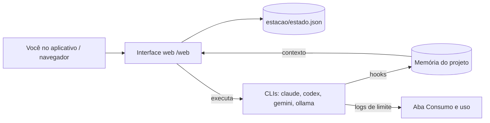

# Visão geral

A Estação-ai (versão **1.7.1**) é uma central local para coordenar vários agentes de IA (Claude Code, Codex, Antigravity, Gemini, Ollama e outros) em salas de chat 2D/3D e projetos de software com memória de longo prazo. O painel (`/web/`) utiliza autenticação descentralizada via **Nostr** (chave privada `nsec` / hex, QR Code NIP-46 ou extensão NIP-07) com sessão persistente.

## Telas
| Tela | Endereço | Nota |
|---|---|---|
| Chats e Chalé 3D | `/web/chat` | salas pessoais e compartilhadas (Nostr), debates, personagens caninos e Chalé 3D |
| Projetos | `/web/projetos` | [[Projetos e tarefas]] |
| Projeto expandido | `/web/projetos/<id>` | Pensador como orquestrador, painel lateral TAREFAS, multi-terminal integrado e memória |
| Modelos de IA | `/web/modelos` | papéis pré-definidos (abas Chat e Projetos) e [[Agentes]] |
| Consumo e uso | `/web/consumo` | [[Consumo e limites]] |
| Documentação | `/web/docs` | guias e [[Tutorial completo]] integrados |
| Memória e contextos | `/web/` | painel de memória, páginas e grafo |

## Onde ficam os dados
- **Estado da Estação** (agentes, projetos, tarefas, mensagens, contatos e sessões — com gravação atômica): `~/.local/share/estacao-ai/estacao/estado.json` (Linux) ou `%LOCALAPPDATA%\estacao-ai\estacao\estado.json` (Windows).
- **Memória** (páginas, sessões, tokens): banco SQLite em `~/.local/share/estacao-ai/db/` (Linux) ou `%LOCALAPPDATA%\estacao-ai\db\` (Windows).

Relacionadas: [[Chats e orquestração]], [[Projetos e tarefas]], [[Contextos e memória]].
